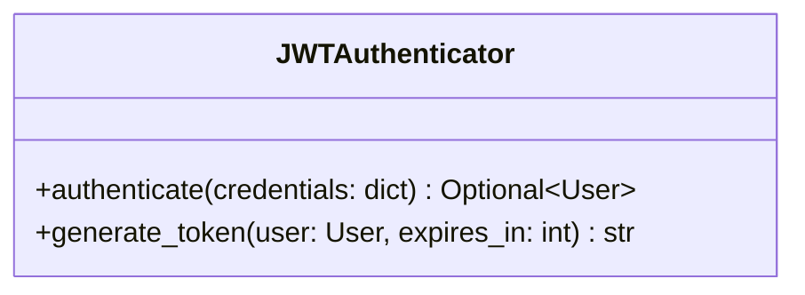

# PR Documentation with UML Skill

A comprehensive skill for generating high-quality Pull Request documentation with accurate UML diagrams using Mermaid.

## Overview

This skill helps agents create PR documentation that:
- Explains code changes clearly
- Visualizes architecture and flow with UML diagrams
- **Ensures all code element names match actual code exactly** (via static analysis)

## Installation

Copy this skill directory to your Kimi CLI skills folder:

```bash
cp -r pr-documentation-uml ~/.kimi/skills/
```

Or use it directly with the `--skills-dir` flag:

```bash
kimi --skills-dir /path/to/skills/pr-documentation-uml
```

## Skill Structure

```
pr-documentation-uml/
├── SKILL.md                      # Main skill definition
├── README.md                     # This file
├── references/
│   ├── PR_TEMPLATE.md            # PR documentation template
│   └── MERMAID_SYNTAX.md         # Mermaid syntax quick reference
├── scripts/
│   ├── analyze_code.py           # Python static analysis tool (executable)
│   └── README.md                 # Scripts documentation
├── examples/
│   ├── 01_basic_class_analysis.py       # Executable example: simple classes
│   ├── 02_inheritance_analysis.py       # Executable example: inheritance
│   ├── 03_decorator_analysis.py         # Executable example: decorators
│   └── README.md                        # Examples documentation
└── tests/
    ├── test_01_basic_class_analysis.py  # Tests for example 01
    ├── test_02_inheritance_analysis.py  # Tests for example 02
    ├── test_03_decorator_analysis.py    # Tests for example 03
    └── README.md                        # Tests documentation
```

## Quick Start

### 1. Activate the Skill

The skill is automatically loaded when Kimi CLI starts if placed in `~/.kimi/skills/`.

You can manually invoke it with:

```bash
/skill:pr-documentation-uml
```

### 2. Basic Workflow

```bash
# Step 1: Check what changed
git diff main...feature-branch --name-only

# Step 2: Analyze changed files
python scripts/analyze_code.py src/modified_file.py

# Step 3: Create PR doc with UML (agent does this)
# - Use exact names from analysis
# - Choose appropriate UML diagram types
# - Follow PR_TEMPLATE.md structure
```

## Key Features

### 🔍 Static Code Analysis

The `scripts/analyze_code.py` tool extracts accurate code structure:

```bash
python scripts/analyze_code.py src/auth/authenticator.py
```

Output includes:
- Class names and inheritance
- Method signatures with parameters and return types
- Attributes with type annotations
- Imports and dependencies

### 📊 UML Diagram Generation

Supports multiple diagram types:

| Diagram Type | Use Case |
|--------------|----------|
| Class Diagram | Class relationships, inheritance |
| Sequence Diagram | API flows, interactions |
| State Diagram | Workflow states, FSM |
| Flowchart | Business logic, decisions |
| ER Diagram | Database schema |
| Architecture Diagram | Module dependencies |

### ✅ Accuracy Guarantee

The skill enforces exact naming:
- Always analyze code before drawing UML
- Copy names directly from analysis output
- Verify with ReadFile/Grep when needed
- No guessing or simplification

## Example Usage

### Scenario: Adding Authentication

```bash
# 1. Analyze the new auth module
python scripts/analyze_code.py src/auth/authenticator.py
```

Analysis output:
```
Classes:
  JWTAuthenticator(BaseAuthenticator)
    Methods:
      + authenticate(credentials: dict) -> Optional[User]
      + generate_token(user: User, expires_in: int) -> str
```

### 2. Create UML with Exact Names



**Note**: All names match analysis exactly!

## Reference Materials

### SKILL.md
Complete skill instructions including:
- When to use
- Workflow steps
- Critical rules for accuracy
- Best practices

### PR_TEMPLATE.md
Standard PR documentation structure:
- Change overview
- Reason for changes
- Implementation details
- UML diagrams
- Testing instructions
- Impact analysis

### MERMAID_SYNTAX.md
Quick reference for Mermaid syntax:
- Class diagram relationships
- Sequence diagram messages
- State transitions
- Flowchart nodes
- ER diagram cardinality

### Examples (Executable)
Python scripts demonstrating:
- How to use the analysis tool programmatically
- How to generate UML from analysis results
- Handling different code patterns (classes, inheritance, decorators)
- Each example includes functions you can import and reuse

### Tests (pytest-based)
Comprehensive test suite with 32 tests:
- Validates analysis accuracy
- Ensures correct name extraction
- Verifies UML generation
- Provides usage examples
- Uses pytest fixtures and markers
- Supports parallel execution and coverage reporting

Run tests:
```bash
pytest                    # Run all tests
pytest -m basic          # Run basic tests only
pytest -m inheritance    # Run inheritance tests only
pytest -m decorators     # Run decorator tests only
pytest --cov=scripts     # With coverage report
```

## Requirements

### For the Skill
- Kimi CLI with skills support
- Git (for diff commands)

### For Static Analysis Tool
- Python 3.10+
- No external dependencies (uses standard library)

### For Development/Testing
- pytest >= 7.4.0 (optional, for running tests)
- pytest-cov >= 4.1.0 (optional, for coverage reports)

Install development dependencies:
```bash
pip install -r requirements-dev.txt
```

### For UML Rendering
- GitHub/GitLab (renders Mermaid natively)
- VS Code with Mermaid extension
- Mermaid Live Editor (https://mermaid.live)

## Best Practices

1. **Always Analyze First**
   ```bash
   python scripts/analyze_code.py <file>
   ```

2. **Use Exact Names**
   - Copy from analysis output
   - Don't simplify or generalize

3. **Choose Right Diagram**
   - Class diagram for structure
   - Sequence diagram for flow
   - State diagram for FSM
   - Flowchart for logic

4. **Verify Accuracy**
   ```bash
   # Double-check with grep
   grep -n "class JWTAuthenticator" src/auth/authenticator.py
   ```

5. **Test Rendering**
   - Paste Mermaid code to https://mermaid.live
   - Verify it renders correctly

## Common Pitfalls

❌ **Don't guess names**
```mermaid
class AuthService  # Wrong if actual name is Authenticator
```

❌ **Don't simplify signatures**
```mermaid
+login()  # Wrong if actual is authenticate(credentials: dict)
```

❌ **Don't skip analysis**
```
# Wrong workflow:
1. Look at code
2. Draw UML from memory
```

✅ **Correct workflow**
```
1. Run analyze_code.py
2. Copy exact names
3. Generate UML
4. Verify with grep
```

## Contributing

To improve this skill:

1. **Add more examples** in `examples/analysis/`
2. **Enhance analysis tool** in `scripts/analyze_code.py`
3. **Improve templates** in `references/`

## License

Apache-2.0

## Version

1.0.0

## Author

kimi-cli

---

For questions or issues, refer to the examples in `examples/analysis/` or check the main skill file `SKILL.md`.

