# Mermaid Syntax Quick Reference

This document provides essential Mermaid syntax for creating UML diagrams. For complex scenarios, refer to examples in the `examples/` directory.

## Basic Structure

All Mermaid diagrams start with a type declaration:

```mermaid
<diagram-type>
    <diagram-content>
```

## 1. Class Diagram

### Basic Syntax

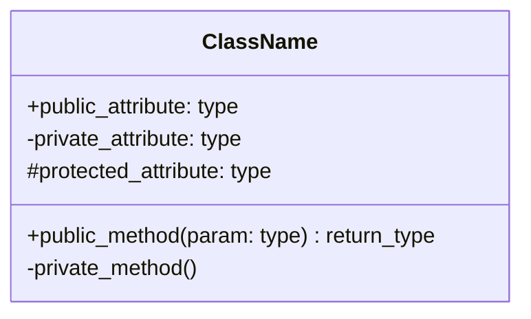

### Relationships

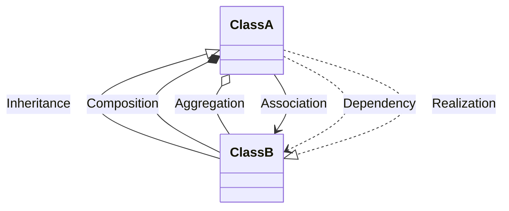

### Visibility Modifiers

- `+` Public
- `-` Private
- `#` Protected
- `~` Package/Internal

## 2. Sequence Diagram

### Basic Syntax

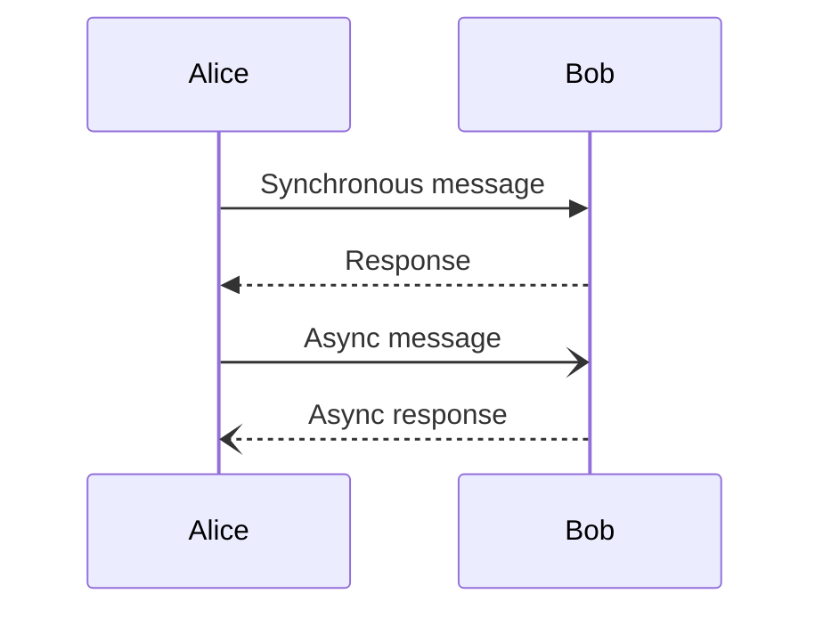

### Advanced Features

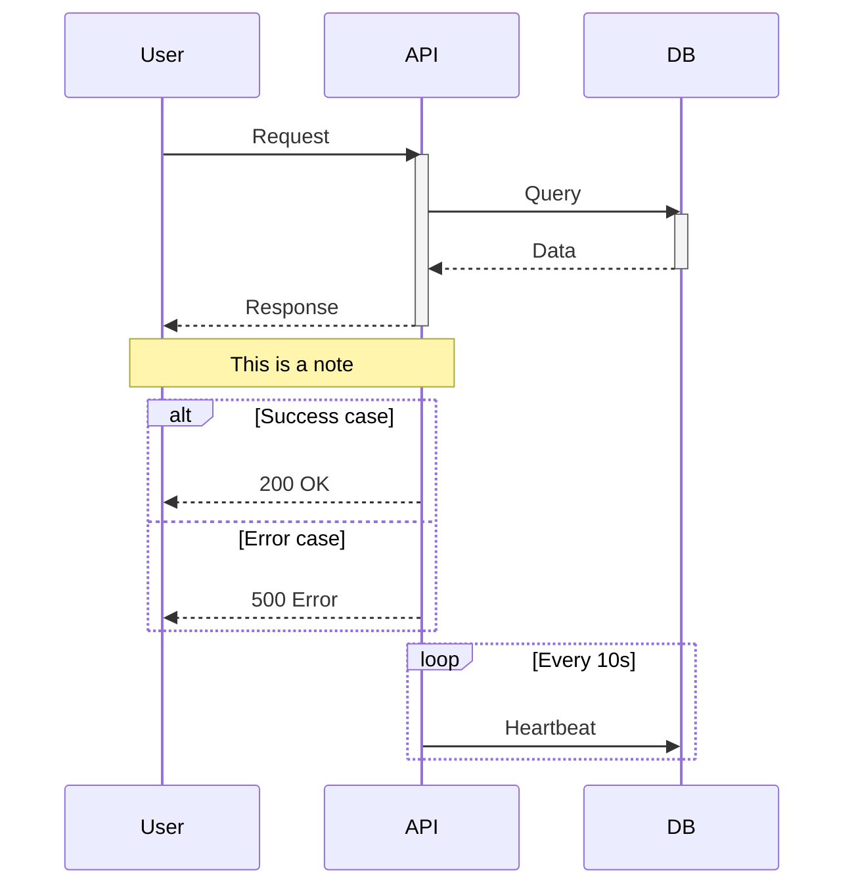

### Message Types

- `->` Solid line without arrow
- `-->` Dotted line without arrow
- `->>` Solid line with arrow
- `-->>` Dotted line with arrow
- `-x` Solid line with X
- `--x` Dotted line with X
- `-)` Async solid line
- `--)` Async dotted line

## 3. Flowchart

### Basic Syntax

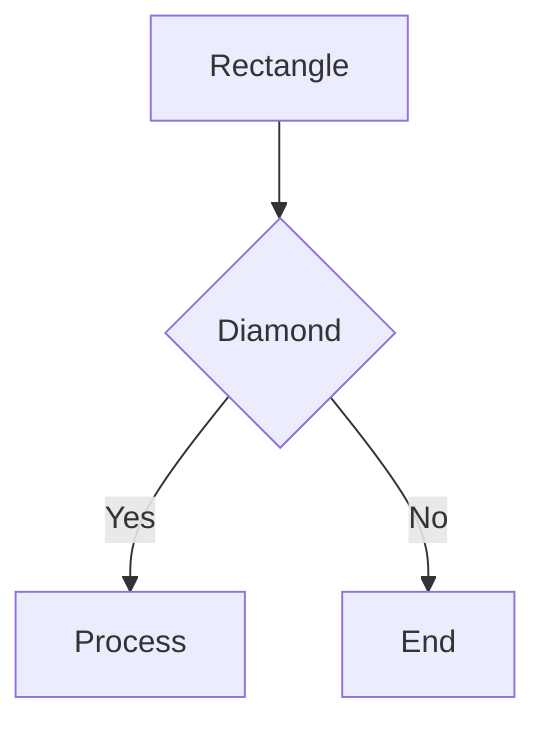

### Node Shapes

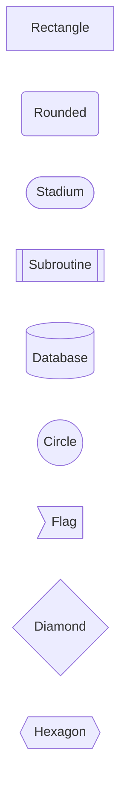

### Directions

- `TD` / `TB` - Top to Down/Bottom
- `BT` - Bottom to Top
- `LR` - Left to Right
- `RL` - Right to Left

## 4. State Diagram

### Basic Syntax

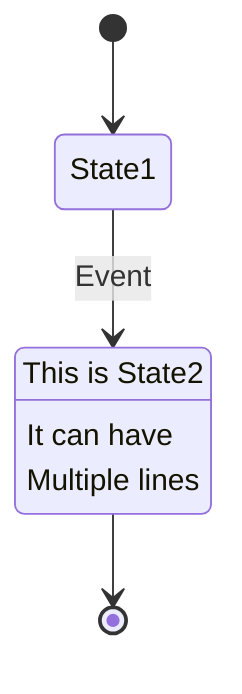

### Composite States

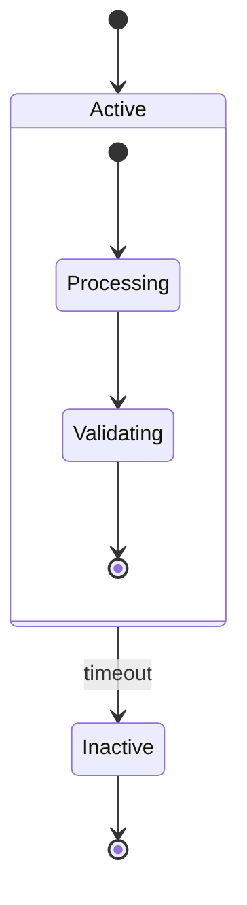

## 5. ER Diagram

### Basic Syntax

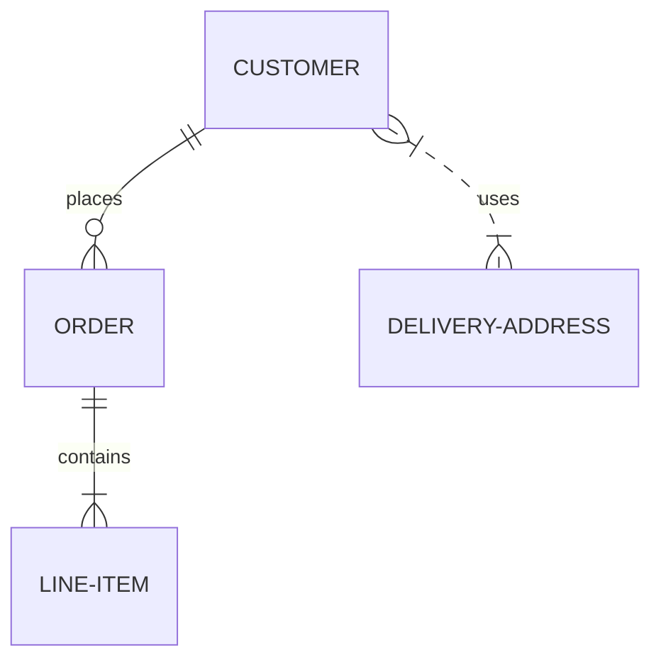

### Relationship Cardinality

- `||--||` One to one
- `||--o{` One to many
- `}o--o{` Many to many
- `||..|{` Zero or more

### Entity Attributes

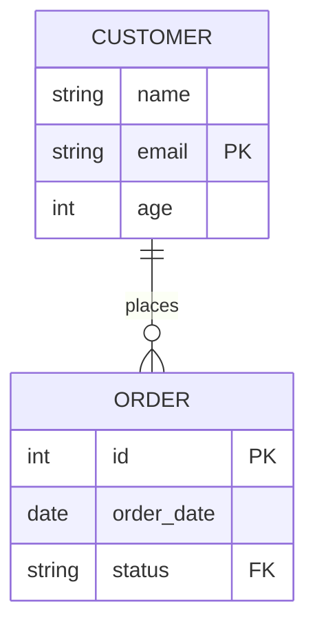

## 6. Graph/Architecture Diagram

### Basic Syntax

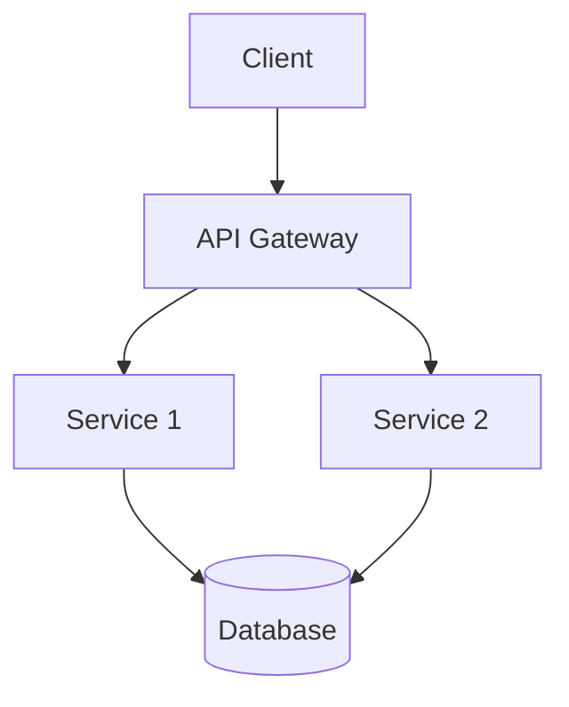

### Subgraphs

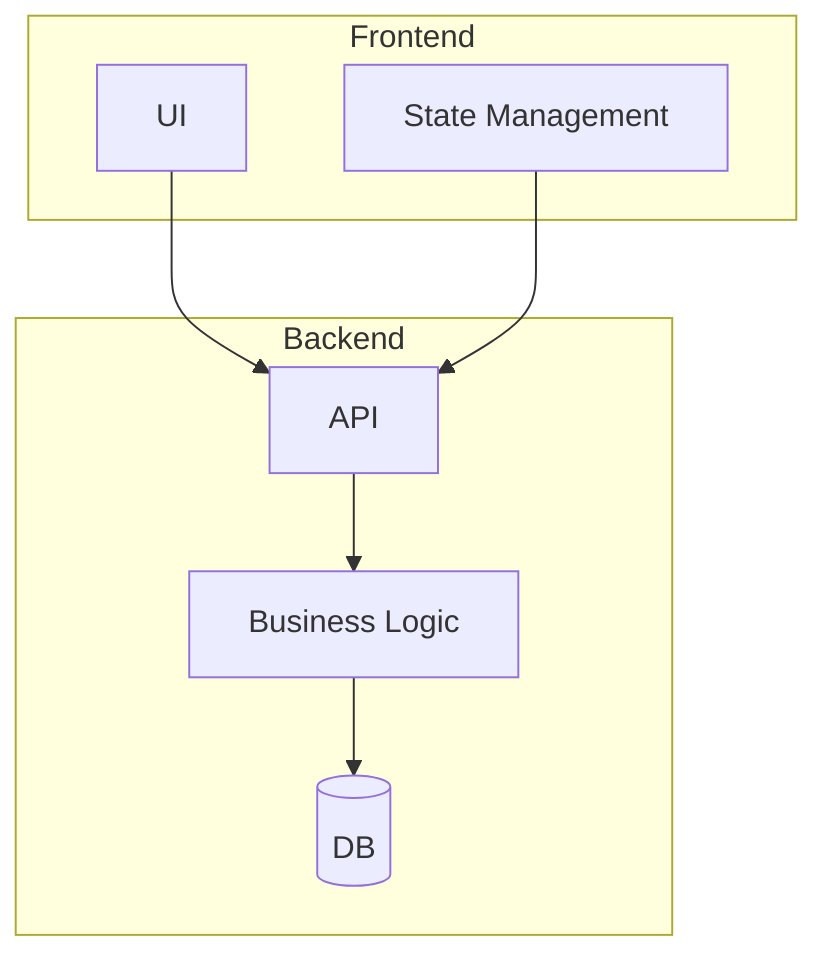

## Styling Tips

### Custom Styles

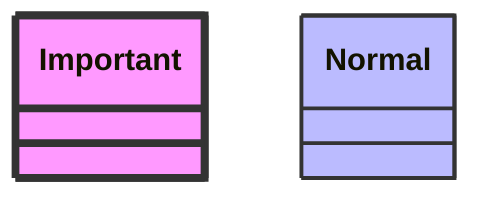

### CSS Classes

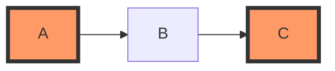

## Best Practices

1. **Keep It Simple** - One diagram should focus on one aspect
2. **Use Meaningful Names** - Use actual code names, not generic ones
3. **Add Annotations** - Use `Note` blocks to clarify complex parts
4. **Consistent Naming** - Keep naming consistent across diagrams
5. **Test Rendering** - Verify diagrams render correctly on GitHub/GitLab

## Common Pitfalls

- **Syntax Errors** - Missing colons, brackets, or quotes
- **Name Mismatches** - UML names don't match actual code
- **Too Complex** - Too many elements in one diagram
- **Wrong Diagram Type** - Using wrong diagram for the use case

## Testing Your Diagrams

Test your Mermaid code:
- [Mermaid Live Editor](https://mermaid.live/)
- GitHub/GitLab Markdown preview
- VS Code with Mermaid extension

## Further Reading

For complete syntax reference:
- [Mermaid Official Documentation](https://mermaid.js.org/)
- Examples in `examples/` directory

