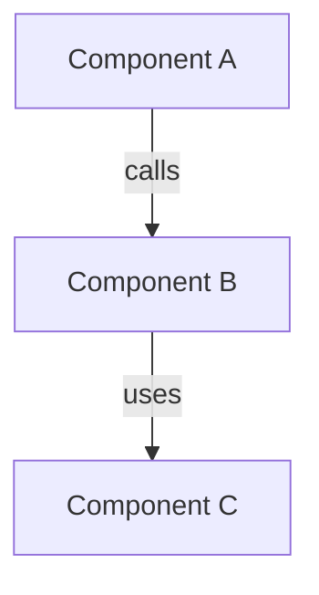
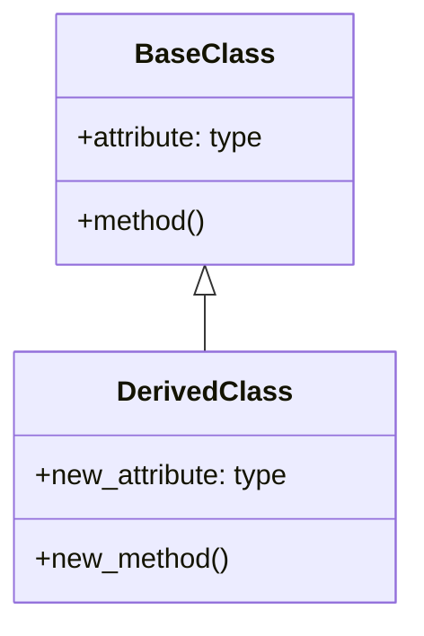
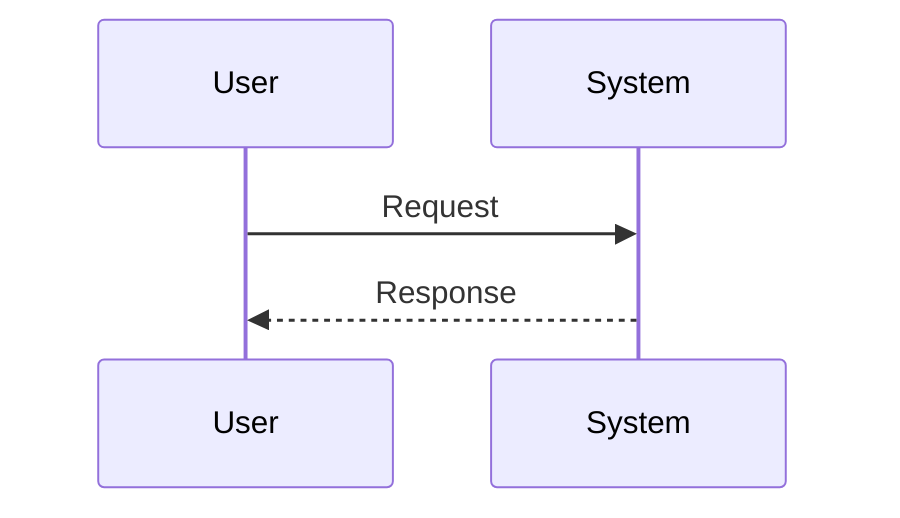

# PR Documentation Template

Use this template to structure your Pull Request documentation. Replace sections with actual content based on code analysis.

---

## 📋 Change Overview

**Brief summary (1-2 sentences):**

[Describe the main purpose of this PR]

**Related Issue/Ticket:**

- Issue #XXX
- JIRA-XXXX

**Change Type:**

- [ ] Feature
- [ ] Bug Fix
- [ ] Refactoring
- [ ] Performance Improvement
- [ ] Documentation
- [ ] Testing

---

## 🎯 Reason for Changes

### Problem Statement

[Explain the problem or requirement that motivated this change]

### Why This Approach

[Explain why you chose this particular implementation approach]

---

## 📝 Change Details

### Modified Files

List key files and their changes:

- `path/to/file1.py` - Added new class `ClassName` for handling X
- `path/to/file2.py` - Modified method `method_name()` to support Y
- `path/to/file3.py` - Removed deprecated function `old_function()`

### Code Statistics

```bash
git diff --stat main...HEAD
```

[Paste statistics here]

---

## 🏗️ Architecture Diagrams

### System Architecture

[If architecture changed, show before/after or new architecture]



### Class Relationships

[Show class diagram for new/modified classes]



### Sequence Flow

[Show key interaction flows]



---

## 💡 Implementation Details

### Key Changes

#### 1. [Feature/Component Name]

**What:** [Describe what was implemented]

**How:** [Explain the implementation approach]

**Code Example:**

```python
# Show key code snippet with actual names from code
class ActualClassName:
    def actual_method_name(self, param: ActualType) -> ReturnType:
        # Implementation
        pass
```

#### 2. [Another Key Change]

[Continue for other significant changes]

### Design Decisions

- **Decision 1:** [Why you chose approach X over Y]
- **Decision 2:** [Trade-offs considered]

### Technical Considerations

- **Performance:** [Any performance implications]
- **Security:** [Any security considerations]
- **Scalability:** [How this scales]
- **Compatibility:** [Breaking changes or backward compatibility]

---

## 🧪 Testing

### Test Coverage

- [ ] Unit tests added/updated
- [ ] Integration tests added/updated
- [ ] Manual testing completed

### How to Test

```bash
# Steps to verify the changes
python -m pytest tests/test_new_feature.py
```

### Test Cases

1. **Scenario 1:** [Description]
   - Input: [Example input]
   - Expected: [Expected result]
   - Actual: [Actual result]

2. **Scenario 2:** [Description]
   - ...

---

## 🔍 Impact Scope

### Affected Modules

- **Module A** - [How it's affected]
- **Module B** - [How it's affected]

### Breaking Changes

- [ ] No breaking changes
- [ ] Has breaking changes (list below)

[If breaking changes, list them with migration guide]

### Dependencies

- **New dependencies added:**
  - `package-name==version` - [Why needed]

- **Dependencies updated:**
  - `package-name: 1.0 → 2.0` - [Reason for upgrade]

---

## 📚 Additional Notes

### Future Work

[Any follow-up work or known limitations]

### References

- [Link to design doc]
- [Link to related PRs]
- [Link to documentation]

---

## ✅ Checklist

- [ ] Code follows project style guidelines
- [ ] Self-review completed
- [ ] Comments added for complex logic
- [ ] Documentation updated
- [ ] Tests pass locally
- [ ] No new warnings introduced
- [ ] Commit messages follow conventions

